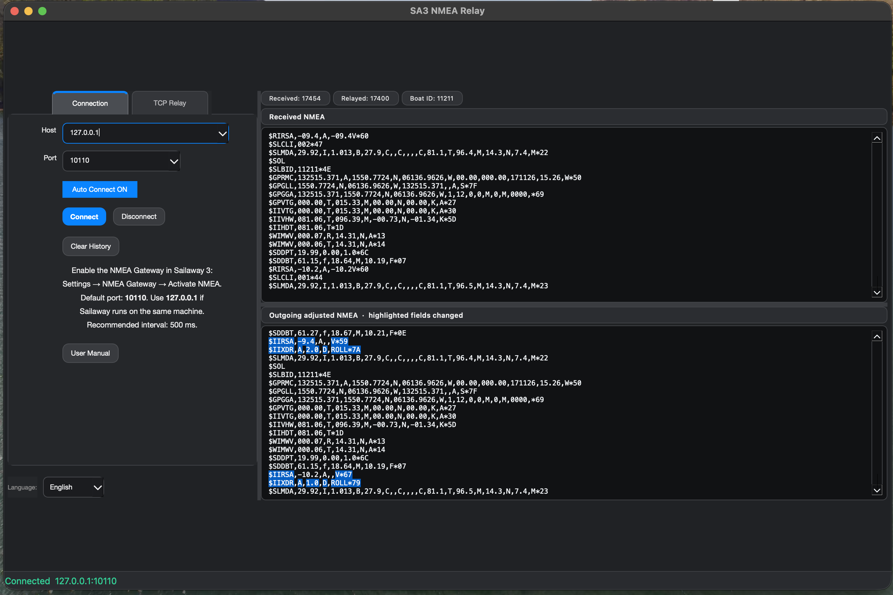

# SA3 NMEA Relay

## What is SA3 NMEA Relay?

SA3 NMEA Relay bridges the **Sailaway 3** sailing simulator's built-in NMEA gateway to navigation software such as **OpenCPN** or **qtVlm**. Sailaway outputs NMEA 0183 sentences over a local TCP connection; this app receives them, applies corrections for compatibility with standard chart plotters, and re-broadcasts the corrected stream over a second TCP port.

### Receive from Sailaway

Connects to the Sailaway NMEA gateway (default `127.0.0.1:10110`) and reads the live NMEA stream.

### Correct and filter

Fixes non-standard sentences and removes your own vessel from the AIS feed so other traffic remains visible.

### Re-broadcast via TCP Relay

Serves the corrected stream on a configurable port (default `10111`) that OpenCPN or qtVlm connects to as an NMEA source.

### Runs in the background

Lives in the macOS menu bar or Windows system tray, relaying data while you sail.

## NMEA Corrections Applied

Sailaway outputs several proprietary or non-standard sentences. SA3 NMEA Relay rewrites them into standard NMEA 0183 equivalents before passing them to your navigation software.

| Input sentence | Output sentence | Description |
|---|---|---|
| `$SLCLI` | `$IIXDR,A,…,D,ROLL` | Sailaway heel angle becomes a standard XDR transducer sentence. Heel sign inversion is off by default and can be enabled in TCP Relay settings. |
| `$RIRSA` | `$IIRSA` | Sailaway rudder angle becomes a standard RSA sentence with the talker ID corrected to `II`. |
| `$WIMWV` | `$WIMWV` (corrected) | Wind angles greater than 180° are rewritten as negative (signed ±180°) for compatibility with OpenCPN. |
| AIS VDM sentences | Dropped | AIS position reports for your own boat are removed so your vessel does not appear as a separate AIS target. |

All other NMEA sentences (GPS position, SOG, COG, depth, heading, and others) pass through unchanged with their checksums intact.

## Requirements

- Sailaway 3 with the **NMEA Gateway** enabled in its settings
- macOS 11 or later, or Windows 10 or later
- Navigation software that accepts a TCP NMEA source, such as OpenCPN or qtVlm

SA3 NMEA Relay, Sailaway 3, and your navigation app can run on the same computer. The relay listens on `0.0.0.0`, so chart plotters on other devices on the local network can also connect.

## First Use – Step by Step

1. **Choose your language.** On first launch, choose English, Français, Deutsch, or Nederlands. You can change the language from the selector at the bottom of the left panel.
2. **Enable the NMEA Gateway in Sailaway 3.** Go to **Settings → NMEA Gateway** and switch it on. Note the host and port, usually `127.0.0.1` and `10110`.
3. **Enter the Sailaway connection details.** In the **Connection** tab, confirm the host (`127.0.0.1`) and port (`10110`) match Sailaway.
4. **Click Connect.** The status bar turns green when connected, and NMEA sentences begin scrolling in the log window.
5. **Start the TCP Relay.** In the **TCP Relay** tab, the host defaults to `0.0.0.0` and the port to `10111`. Click **Start Relay**. The status line shows how many clients are connected. If heel is displayed in the wrong direction in your navigation app (some older qtVlm versions may need this), select **Invert heel sign** below the port.
6. **Connect your navigation software.** In OpenCPN or qtVlm, add a **TCP connection** to `127.0.0.1` (or your computer's local IP from another device) on port `10111`. Your boat position, heading, wind, and AIS traffic will appear on the chart.
7. **Optional: enable Auto Connect and Auto Relay.** Turn on **Auto Connect** in the Connection tab and **Auto Relay** in the TCP Relay tab. The app then connects automatically at startup, or at login if **Start at Login** is enabled.

## Connection Tab

### Host and port

Enter the IP address and port of the Sailaway NMEA Gateway. The default `127.0.0.1:10110` works for a local installation. Previously successful addresses are saved in the dropdown history.

### Connect and disconnect

**Connect** opens the TCP socket to Sailaway. While connecting, the status bar shows *Connecting…* in yellow; when connected it turns green. Errors appear in red.

**Disconnect** closes the socket cleanly. The relay server continues running and serving its existing clients.

### Auto Connect

When enabled, the app automatically tries to connect using the last saved host and port at startup. If Sailaway is not running, it retries every **10 seconds**. If an established connection drops unexpectedly, or no complete NMEA sentence arrives for 10 seconds, the app displays a notification and retries until it reconnects. Turn off Auto Connect or click **Disconnect** to stop retries.

Auto Connect can be enabled or disabled at any time. The app sends one notification when an established connection is lost, then another when it reconnects.

## TCP Relay Tab

### Relay host and port

`0.0.0.0` makes the relay accessible from any device on your local network. Change it to `127.0.0.1` to restrict access to this computer. The default port is `10111`.

### Heel sign

The **Invert heel sign** checkbox is directly below the relay port and is disabled by default. It reverses the sign of Sailaway heel values in the outgoing XDR sentence: positive values become negative and negative values become positive, switching the port/starboard convention. Some older qtVlm versions may need this enabled. The setting is saved and can be changed while the relay is running.

### Start and stop Relay

**Start Relay** opens the listening server. Multiple navigation apps can connect simultaneously; the client count is shown next to the button.

### Auto Relay

The relay server starts automatically at launch using the last saved host and port.

The relay server runs independently of the Sailaway connection. You can start it before connecting to Sailaway; it will have no data to send until the connection is established.

## Menu Bar and System Tray

SA3 NMEA Relay lives in the macOS menu bar or Windows system tray. Closing the main window hides it rather than quitting; the relay keeps running in the background.

### Reading the tray icon

The icon reuses the app logo: the boat color shows Sailaway connection status, and the background shows whether a relay client is connected. Hover over the icon or open its menu to see the exact client count.

| Boat | Background | Meaning |
|---|---|---|
| 🟢 Green | 🔵 Blue | Sailaway connected; at least one client connected |
| 🟠 Amber | 🔵 Blue | Sailaway connecting or reconnecting; at least one client connected |
| 🔴 Red | 🔵 Blue | Sailaway disconnected; at least one client connected |
| 🟢 Green | ⚫ Charcoal | Sailaway connected; no client connected |

### Tray menu options

- **Hide / Show** toggles the main window.
- **Menu Bar / Tray Only** saves the preference to start the window hidden next time. Use **Hide / Show** to hide or reveal it now. On macOS, the Dock icon stays hidden while the app is running; use the menu bar icon to show the window.
- **Start at Login** configures automatic startup when you log in.
- **Help** opens this manual.
- **Quit** exits the app completely.

### Notifications

A system notification appears shortly after launch confirming the app is running, and again each time a connection to Sailaway is successfully established.

## Start at Login

Enable **Start at Login** from the tray menu to have SA3 NMEA Relay launch automatically when you log in.

Combined with **Auto Connect**, **Auto Relay**, and **Menu Bar / Tray Only** mode, the hands-free workflow is:

1. Log in. SA3 NMEA Relay launches automatically and hides to the menu bar or system tray.
2. Start Sailaway 3. The relay detects the NMEA gateway and connects automatically, retrying every 10 seconds if needed.
3. Open OpenCPN or qtVlm. Your navigation software connects to the relay on port `10111`; position, wind, and AIS data appear on the chart.

On macOS, Start at Login uses a LaunchAgent at `~/Library/LaunchAgents/com.sa3nmearelay.plist`. On Windows, it writes a value to `HKCU\Software\Microsoft\Windows\CurrentVersion\Run`.

## Language

The app supports English, Français, Deutsch, and Nederlands. The language selector is at the bottom of the left panel. Your choice is saved and restored at the next launch.

On first launch, a pop-up asks you to choose a language before the main window opens.

## Troubleshooting

### Cannot connect to Sailaway

- Confirm the NMEA Gateway is enabled in Sailaway's settings.
- Check that the host and port match Sailaway's configuration.
- Make sure no firewall is blocking the connection on that port.

### Navigation software shows no data

- Confirm the TCP Relay is running; the status line shows the port and client count.
- Check that your navigation app is configured to connect to `127.0.0.1` on port `10111` (or the port you configured).
- Check the NMEA log window. If sentences are scrolling, the relay is receiving data.

### Connection keeps retrying

- Check that Sailaway is running and the NMEA Gateway is enabled.
- Turn off Auto Connect or click **Disconnect** to stop automatic retries.

### Dock icon does not disappear on macOS

Quit any older copy and launch the updated Mac app. It is configured to run from the menu bar without a Dock icon.

The scrolling log in the main window shows each NMEA sentence received and system messages (prefixed with `#`). It can help diagnose connection or data issues.
